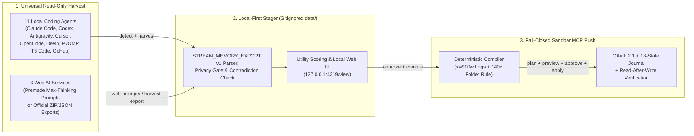

# Stream Memory Manager

[](https://github.com/jerryj6/stream-memory-manager/actions/workflows/ci.yml)
[](https://www.python.org/downloads/)
[](LICENSE)
[](https://modelcontextprotocol.io/)

**Migrate your entire personal and technical AI context from every coding agent and web AI chat into [Sandbar Stream](https://www.sandbar.com/) — repeatably, privately, and with zero duplicate Logs.**

---

## Use With Any Coding Agent (Copy-Paste Setup)

Drop this prompt into **Claude Code, OpenAI Codex, Google Antigravity, Cursor, OpenCode, Pi/OMP, Devin, or Windsurf**:

```text
Clone https://github.com/jerryj6/stream-memory-manager, run `uv sync`, and follow SKILL.md step-by-step:
1. Auto-detect my local coding agents (`stream-memory detect --json`).
2. Ask me which local agents and web AI services I actually use (and anything off-limits).
3. Harvest my confirmed sources using the premade max-thinking `web-prompts` kit (never rewrite prompts from scratch) or official exports.
4. Stage everything in the local review UI (`stream-memory ui --port 4319`) so I can inspect/edit before compiling.
5. Authenticate via official Sandbar OAuth 2.1, run a 1-Log canary first, and push cleanly into my Sandbar Stream `Memory` folder after my explicit approval.
```

---

## Why This Exists (And Why a Simple Upload Script Breaks)

Sandbar Stream's official MCP server (`https://api.sandbar.com/mcp`) has real production constraints that make naive scripts risky:

| Sandbar Stream MCP Constraint | How Stream Memory Manager Handles It |
| :--- | :--- |
| **No delete tool & no Log-edit tool via MCP** | Every write requires an immutable, previewed, explicitly approved `plan_id`. Ambiguous failures halt and reconcile instead of blindly retrying and flooding your account with undeletable duplicates. |
| **1,000-word max per Log** (including title) | Semantic Markdown compiler splits safely at `<= 900` conservative words (preserving headings, code blocks, and bullets) and builds a `CORE — Knowledge Index`. |
| **Flat folders only & `<= 140`-char routing instruction** | Compiles everything cleanly into one dedicated `Memory` folder with a validated `<= 140`-char instruction and consistent category prefixes (`CORE —`, `PREFERENCES —`, `ENGINEERING —`, etc.). |
| **Block-array `content` readback & summary previews** | Live-verified against production Sandbar MCP: parses `[{"type":"text","text":"..."}]` block arrays (with title in `content[0]`) and hydrates `list_artifacts` summary previews via `get_artifact` for exact bit-for-bit deduplication. |
| **Strict rate limits (~1 req/s) & 1-hour OAuth tokens** | SQLite-persisted conservative pacing (survives restarts), OS Keychain OAuth 2.1 + PKCE (`S256`) with automatic silent token refresh, and an 18-state crash-recoverable operation journal. |

---

## Architecture



---

## Supported Platforms

### Local Coding Agents & Dev Environments (11 Auto-Detected, Read-Only, Secret-Redacted)

| Source ID | Tool / Environment | Safety Guarantees |
| :--- | :--- | :--- |
| `claude_code` | Claude Code (`~/.claude`) | JSONL user prompts only; skips `.env`, tokens, credentials |
| `codex` | OpenAI Codex (`~/.codex`) | Session & history prompts only; never reads `auth.json` |
| `antigravity` | Google Antigravity (`~/.gemini/antigravity`) | Brain metadata & user inputs only; secrets redacted |
| `cursor` | Cursor (`workspaceStorage/*/state.vscdb`) | Strictly read-only SQLite URI (`?mode=ro`) |
| `opencode` | OpenCode (`~/.local/share/opencode`) | Read-only config & session summaries |
| `devin` | Devin CLI (`~/.devin`) | Read-only local logs/configs |
| `pi_omp` | Pi / Oh-My-Pi (`~/.omp`) | Reads ONLY `history.db` (`?mode=ro`); strictly skips `agent.db` credentials |
| `t3_code` | T3 Code (`~/.t3`, `~/.config/t3-code`) | Read-only session metadata |
| `other_agents` | Windsurf, Cline, Roo Code, Aider | Read-only local artifacts |
| `global_instructions` | `AGENTS.md`, `CLAUDE.md`, `GEMINI.md` | Redacts any embedded secrets before staging |
| `github` | GitHub CLI (`gh`) | Authenticated repo inventory metadata only |

### Web AI Services (8 Supported — Asked Dynamically, Never Guessed)

| Service ID | Platform | Premade Max-Thinking Prompt (`STREAM_MEMORY_EXPORT v1`) | Official Export Parser (`harvest-export`) |
| :--- | :--- | :---: | :---: |
| `chatgpt` | ChatGPT (OpenAI) | Yes (High / Heavy / Extended Thinking) | Yes (`.zip` / `conversations.json`) |
| `claude` | Claude.ai (Anthropic) | Yes (Opus + Extended Thinking) | Yes (`.zip` / `conversations.json`) |
| `gemini` | Google Gemini | Yes (Pro / Thinking / Deep Think) | Yes (Takeout JSON) |
| `grok` | Grok (xAI) | Yes (Heavy / Think / Expert) | — |
| `perplexity` | Perplexity | Yes (Pro / Max Reasoning) | — |
| `t3_chat` | T3 Chat | Yes (Active thread / custom instructions) | Yes (JSON) |
| `deepseek` | DeepSeek Chat | Yes (DeepThink R1) | Yes (JSON) |
| `duck_ai` | Duck.ai | Ephemeral (open tab only; no fake cross-chat prompts) | — |

---

## 30-Second Local Demo (Zero Sandbar Account Needed)

Try the full staging, privacy review, compiler, and local `/view` UI immediately using the included synthetic example ([examples/sample_context.md](examples/sample_context.md)):

```bash
git clone https://github.com/jerryj6/stream-memory-manager.git
cd stream-memory-manager
uv sync

# Ingest the synthetic example, approve clean records, and compile
uv run stream-memory ingest examples/sample_context.md --json
uv run stream-memory privacy-review --approve-all-clean --json
uv run stream-memory compile --json

# Open the ephemeral localhost review UI (strictly 127.0.0.1, CSRF-protected)
uv run stream-memory ui --port 4319
# -> Open http://127.0.0.1:4319/view
```

---

## Full End-to-End Migration Workflow

```bash
# 1. Detect installed local coding agents & supported web AI catalog
uv run stream-memory detect --json

# 2. Harvest ONLY the local sources you want (read-only, secret-redacted)
uv run stream-memory harvest --sources claude_code,codex,github --json

# 3. Emit premade max-thinking standardized prompts ONLY for web AIs you use
uv run stream-memory web-prompts --services chatgpt --mode full --raw
# Incremental delta later (auto-fills already-staged sections from SQLite!):
uv run stream-memory web-prompts --services claude --mode delta --covered-from-db --raw
# Or digest an official export archive directly:
uv run stream-memory harvest-export ~/Downloads/chatgpt-export.zip --json

# 4. Ingest, review visually in /view, and compile
uv run stream-memory ingest data/harvested/web_chatgpt_full.md --json
uv run stream-memory ui --port 4319
uv run stream-memory compile --json

# 5. Authenticate to Sandbar Stream (official OAuth 2.1 + PKCE -> OS Keychain)
uv run stream-memory auth connect --scope "stream stream.write" --confirm-account
uv run stream-memory capabilities --live --json

# 6. Preview an immutable live plan, approve explicitly, and push safely
uv run stream-memory plan --mode live --json
uv run stream-memory preview --plan-id <PLAN_ID>
uv run stream-memory approve --plan-id <PLAN_ID> --note "Approved initial import"
uv run stream-memory apply --plan-id <PLAN_ID> --mode live --json
```

If interrupted by a network drop, rate limit (`429`), or expired OAuth token (`401`), **never restart from scratch**:

```bash
uv run stream-memory status --json
uv run stream-memory reconcile --plan-id <PLAN_ID> --json
uv run stream-memory resume --plan-id <PLAN_ID> --mode live --json
```

---

## CLI Quick Reference

| Command | Purpose |
| :--- | :--- |
| `detect` | Auto-detect local coding agents & list supported web AI platforms |
| `harvest` | Harvest read-only, secret-redacted local agent digests into `data/harvested/` |
| `web-prompts` | Emit premade max-thinking standardized prompts (`--mode full\|delta --covered-from-db --raw`) |
| `harvest-export` | Digest official ChatGPT / Claude / Gemini / DeepSeek / T3 `.zip` or `.json` exports |
| `ingest` | Parse `STREAM_MEMORY_EXPORT v1`, numbered Markdown, JSON, or text into canonical SQLite |
| `privacy-review` | Inspect/approve/exclude records with hard-block secret/PII & prompt-injection guards |
| `ui` | Launch ephemeral localhost review UI (`http://127.0.0.1:4319/view`, zero remote writes) |
| `compile` | Build deterministic `<= 900`-word Stream Logs, Knowledge Index, Briefing, & 140-char folder rule |
| `auth connect\|status\|disconnect` | Manage official Sandbar OAuth 2.1 + PKCE credentials in OS Keychain |
| `capabilities` | Discover & fingerprint live Sandbar MCP tool schemas (`--live`) |
| `plan` / `preview` / `approve` / `apply` | Immutable diff planning, inspection, explicit human approval, and paced verified execution |
| `pause` / `reconcile` / `resume` / `verify` | Safe cancellation, read-only ambiguity resolution, and crash recovery |
| `backup` / `restore` / `doctor` / `export` / `evaluate` | WAL-safe online SQLite backups, health diagnostics, portable bundles, and BM25/native evals |

---

## Credits & Further Documentation

- Local `/view` staging UX, utility/confidence/recency scoring, and token-budgeted Briefing context packing are inspired by [guirguispierre/memoryvault](https://github.com/guirguispierre/memoryvault).
- **Agent Instructions:** [SKILL.md](SKILL.md) | [AGENTS.md](AGENTS.md)
- **Architecture & Safety:** [ARCHITECTURE.md](docs/ARCHITECTURE.md) | [INVARIANTS.md](docs/INVARIANTS.md) | [OPERATION_STATE_MACHINE.md](docs/OPERATION_STATE_MACHINE.md) | [PRIVACY_AND_SECURITY.md](docs/PRIVACY_AND_SECURITY.md)
- **Sandbar MCP & Operations:** [SANDBAR_CAPABILITIES.md](docs/SANDBAR_CAPABILITIES.md) | [MCP_ADAPTER.md](docs/MCP_ADAPTER.md) | [OPERATOR_RUNBOOK.md](docs/OPERATOR_RUNBOOK.md) | [VERIFICATION_MATRIX.md](docs/VERIFICATION_MATRIX.md)
- **Project Policies:** [SECURITY.md](SECURITY.md) | [CONTRIBUTING.md](CONTRIBUTING.md) | [CHANGELOG.md](CHANGELOG.md) | [LICENSE](LICENSE)
