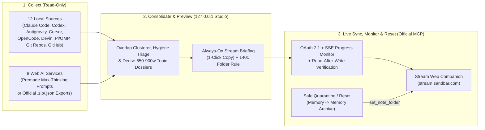

# Stream Memory Manager

[](https://github.com/jerryj6/stream-memory-manager/actions/workflows/ci.yml)
[](https://www.python.org/downloads/)
[](LICENSE)
[](https://modelcontextprotocol.io/)

**Stream Memory Studio** — collect your context from coding agents and web AI chats, consolidate scattered fragments into dense, voice-friendly Topic Dossiers + an Always-On Briefing, monitor live sync against [Sandbar Stream](https://stream.sandbar.com), and safely quarantine/reset stale notes via official MCP.

---

## Run in One Command (No Cloning Needed)

```bash
uvx --from git+https://github.com/jerryj6/stream-memory-manager stream-memory
```

Opens **Stream Memory Studio** locally at `http://127.0.0.1:4319/view` — a calm 4-tab workspace (**1. Collect -> 2. Consolidate -> 3. Briefing & Preview -> 4. Live Sync & Monitor**) with zero telemetry and zero terminal gymnastics.

### Or Plug Into Any Coding Agent (Drop-In Skill)

Install as a standard Agent Skill (Claude Code, Codex, Cursor, Antigravity, OpenCode, Pi/OMP):

```bash
npx skills add jerryj6/stream-memory-manager
```

Or paste directly into your coding agent:

```text
Follow https://github.com/jerryj6/stream-memory-manager/blob/main/SKILL.md to harvest my confirmed local coding agents and web AI chats, consolidate overlapping facts into dense 650-900 word Topic Dossiers + a Stream Briefing, and sync safely to my Sandbar Stream Memory folder after my approval.
```

---

## Why Dense Topic Dossiers Beat Raw Chat Dumps

Dumping 60+ tiny, overlapping notes into Sandbar Stream makes retrieval noisy and scattered. **Stream Memory Studio** solves all five production failure modes:

| Problem | How Stream Memory Studio Solves It |
| :--- | :--- |
| **Scattered, sparse notes** | TF-IDF overlap detection + visual Merge Studio + optional local Ollama/BYOK Auto-Merge consolidate fragments into **~12–25 dense, voice-friendly Topic Dossiers (650–900 words each)** with zero robotic `[Confirmed]` or `Date/Period:` noise. |
| **Missing Always-On Briefing** | Automatically builds a concise **Stream Briefing** with a **1-click Copy** button + direct `stream.sandbar.com` link so Stream always has your core picture on every turn. |
| **Hard to track & verify what's live** | **Live Sync & Monitor** tab connects via official OAuth 2.1 + PKCE, shows an exact live diff table (`In Sync`, `Ready to Push`, `Changed`, `Stale in Stream`), streams real-time SSE progress, and includes a built-in **Live Stream Search Verification Tester**. |
| **No delete tool in Sandbar MCP** | **1-Click Safe Quarantine / Reset:** Uses official `set_note_folder` (with exact float `lastUpdateUnixTs` optimistic concurrency) to move stale or all old notes cleanly into **`Memory Archive`**, resetting `Memory` immediately so you can permanently empty `Memory Archive` in [stream.sandbar.com](https://stream.sandbar.com). |
| **Fragile uploads & duplicate risk** | 18-state crash-safe SQLite operation journal, single-writer account lock, persisted rate limiting, live Sandbar block-array `content` readback (`[{"type":"text","text":"..."}]`), and mandatory read-after-write verification. |

---

## Architecture



---

## Supported Sources

- **12 Local Read-Only Sources (Secret-Redacted):** Claude Code, OpenAI Codex, Google Antigravity, Cursor (`?mode=ro`), OpenCode, Devin CLI, Pi/OMP (`history.db` only — skips `agent.db`), T3 Code, Windsurf/Cline/Roo/Aider, Global `AGENTS.md`/`CLAUDE.md`/`GEMINI.md`, Local Git Repositories (`README.md` + stack), and GitHub CLI (`gh`).
- **8 Web AI Services (Premade Max-Thinking `STREAM_MEMORY_EXPORT v1` Prompts + Official Exports):** ChatGPT, Claude, Gemini, Grok, Perplexity, T3 Chat, DeepSeek, and Duck.ai (ephemeral).

---

## 30-Second Local Demo (Zero Sandbar Account Needed)

```bash
git clone https://github.com/jerryj6/stream-memory-manager.git
cd stream-memory-manager
uv sync
uv run stream-memory ingest examples/sample_context.md --json
uv run stream-memory
# -> Opens Stream Memory Studio at http://127.0.0.1:4319/view
```

---

## Power-User & Agent CLI Reference

Running `stream-memory` with no arguments launches **Stream Memory Studio**. For headless/agent scripting, every step supports `--json`:

| Command | Purpose |
| :--- | :--- |
| `stream-memory` (or `ui`) | Launch Stream Memory Studio at `http://127.0.0.1:4319/view` |
| `detect` / `harvest` | Auto-detect and harvest read-only, secret-redacted local agents & git repos |
| `web-prompts` | Emit premade Max-Thinking prompts (`--services chatgpt --mode full\|delta --covered-from-db --raw`) |
| `harvest-export` | Digest official ChatGPT / Claude / Gemini / DeepSeek / T3 `.zip` or `.json` exports |
| `ingest` / `consolidate` / `merge` | Ingest sources, surface overlaps/fluff, and merge into dense 650–900w Topic Dossiers |
| `privacy-review` / `compile` | Run secret/PII/injection gates and compile natural voice-friendly Stream Notes + Briefing |
| `auth connect\|status\|disconnect` | Manage official Sandbar OAuth 2.1 + PKCE tokens in OS Keychain |
| `inspect-live` / `search-live` | Pull exact live `Memory` & `Memory Archive` diff table and test live Stream search retrieval |
| `plan` / `approve` / `apply` | Immutable diff planning, explicit approval, and paced read-after-write verified push |
| `reset-memory` | Move stale (`--stale-only`) or all `Memory` notes to `Memory Archive` via official MCP (`--confirm-reset`) |
| `backup` / `restore` / `doctor` | WAL-safe online SQLite snapshots with SHA-256 checksums and local health diagnostics |

---

## Credits & Documentation

- Local `/view` UX, utility scoring, and Briefing context packing inspired by [guirguispierre/memoryvault](https://github.com/guirguispierre/memoryvault).
- **Docs:** [SKILL.md](SKILL.md) | [Architecture](docs/ARCHITECTURE.md) | [Live-Verified Sandbar MCP Notes](docs/SANDBAR_MCP.md) | [Security & Recovery](docs/SECURITY_AND_RECOVERY.md) | [Contributing](CONTRIBUTING.md) | [Changelog](CHANGELOG.md)
