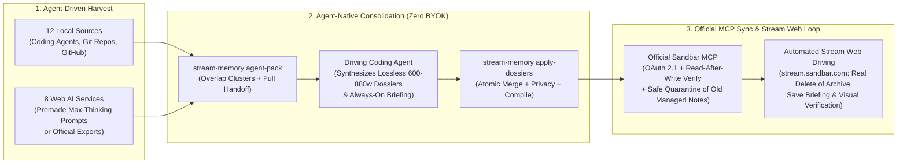

# Stream Memory Manager

[](https://github.com/jerryj6/stream-memory-manager/actions/workflows/ci.yml)
[](https://www.python.org/downloads/)
[](LICENSE)
[](https://modelcontextprotocol.io/)

**Agent-Driven Context Handoff, Consolidation & Live Verification Pipeline for [Sandbar Stream](https://stream.sandbar.com).**

Your coding agent (Antigravity, Claude Code, Codex, Cursor, OpenCode, Pi/OMP) does the intelligence work using its own reasoning — **zero BYOK keys, zero Ollama wrappers**. `stream-memory-manager` gives your agent a structured patch and guidance layer that collects multi-platform context into a lossless handoff, lets the agent synthesize dense 600–880 word Topic Dossiers + an Always-On Briefing in one shot, uploads them cleanly via official Sandbar MCP with read-after-write verification, and closes the loop via automated verification & real deletion in Stream Web.

---

## Plug Into Your Coding Agent (Primary Workflow)

Install as a standard Agent Skill:

```bash
npx skills add jerryj6/stream-memory-manager
```

Or drop directly into any coding agent:

```text
Follow https://github.com/jerryj6/stream-memory-manager/blob/main/SKILL.md to harvest my confirmed local coding agents and web AI chats, assemble a lossless context handoff, consolidate everything using your own reasoning into dense 600-880 word Topic Dossiers + an Always-On Briefing, upload via official Sandbar MCP after my approval, and finish by verifying and permanently cleaning up archived old notes in https://stream.sandbar.com.
```

### Optional Local Visual Companion (Zero-Clone)

Launch **Stream Memory Studio** locally at `http://127.0.0.1:4319/view` anytime to inspect dossiers, copy the Always-On Briefing, or monitor live Stream diffs & SSE progress:

```bash
uvx --from git+https://github.com/jerryj6/stream-memory-manager stream-memory
```

---

## How the Agent-Driven Pipeline Works



---

## Key Capabilities

| Problem | How Stream Memory Manager Solves It |
| :--- | :--- |
| **Scattered, sparse notes** | `agent-pack` surfaces connected-component overlap clusters + hygiene flags so your **coding agent itself** synthesizes **~12–25 dense, voice-friendly Topic Dossiers (600–880 words each)** via `apply-dossiers` — zero robotic `[Confirmed]` or `Date/Period:` noise, zero external BYOK/Ollama setup. |
| **Missing Always-On Briefing** | Automatically compiles a clean, sentence-bounded **Always-On Briefing** (plus 1-click Copy in Studio or automated paste into `https://stream.sandbar.com`). |
| **Personal Stream notes mixed with Memory** | `inspect-live` uses fast preview hydration and tracks every managed artifact ID so stale cleanup only touches old managed Memory notes and **leaves your personal Stream voice notes untouched**. |
| **Real deletion & Stream Web verification** | Official Sandbar MCP (`set_note_folder` with float `lastUpdateUnixTs`) isolates obsolete managed notes into `Memory Archive`; `SKILL.md` then guides your agent's browser tool to drive `https://stream.sandbar.com` directly (using your normal signed-in session) to **permanently delete `Memory Archive`**, save your Briefing, and visually verify the live Memory folder. |
| **Crash-safe, zero-duplicate MCP writes** | 18-state SQLite operation journal, single-writer account lock, persisted rate limiting, live Sandbar block-array `content` parsing (`[{"type":"text","text":"..."}]`), and mandatory read-after-write verification. |

---

## Supported Sources

- **12 Local Read-Only Sources (Secret-Redacted):** Claude Code, OpenAI Codex, Google Antigravity, Cursor (`?mode=ro`), OpenCode, Devin CLI, Pi/OMP (`history.db` only — skips `agent.db`), T3 Code, Windsurf/Cline/Roo/Aider, Global `AGENTS.md`/`CLAUDE.md`/`GEMINI.md`, Local Git Repositories (`README.md` + stack), and GitHub CLI (`gh`).
- **8 Web AI Services (Premade Max-Thinking `STREAM_MEMORY_EXPORT v1` Prompts + Official Exports):** ChatGPT, Claude, Gemini, Grok, Perplexity, T3 Chat, DeepSeek, and Duck.ai (ephemeral).

---

## Agent & Power-User CLI Reference

Every command supports `--json` for clean agent consumption. Running bare `stream-memory` opens the local Studio UI at `http://127.0.0.1:4319/view`.

| Command | Purpose |
| :--- | :--- |
| `detect` / `harvest` | Auto-detect and harvest read-only, secret-redacted local agents & git repos |
| `web-prompts` | Emit premade Max-Thinking prompts (`--services chatgpt --mode full\|delta --covered-from-db --raw`) |
| `harvest-export` / `ingest` | Digest official `.zip`/`.json` exports or `STREAM_MEMORY_EXPORT v1` markdown into SQLite |
| `agent-pack` | Export connected-component overlap clusters + full raw handoff JSON for the driving coding agent |
| `apply-dossiers` | Atomically apply the driving agent's synthesized Topic Dossiers + retirements + privacy check + compile |
| `consolidate` / `merge` | Inspect pairwise overlap / hygiene triage or merge individual records |
| `privacy-review` / `compile` | Run secret/PII/injection gates and compile natural voice-friendly Stream Notes + Briefing |
| `auth connect\|status\|disconnect` | Manage official Sandbar OAuth 2.1 + PKCE tokens in OS Keychain |
| `inspect-live` / `search-live` | Pull fast live `Memory` & `Memory Archive` diff (preserving personal notes) and test live Stream search |
| `plan` / `approve` / `apply` | Immutable diff planning, explicit approval, and paced read-after-write verified push |
| `reset-memory` | Move stale (`--stale-only`) or all `Memory` notes to `Memory Archive` via official MCP (`--confirm-reset`) |
| `ui` / `backup` / `restore` / `doctor` | Launch local Studio (`127.0.0.1:4319`), create SHA-256 WAL-safe SQLite backups, and verify DB health |

---

## 30-Second Local Demo (Zero Sandbar Account Needed)

```bash
git clone https://github.com/jerryj6/stream-memory-manager.git
cd stream-memory-manager
uv sync
uv run stream-memory ingest examples/sample_context.md --json
uv run stream-memory agent-pack --json
uv run stream-memory
# -> Opens Stream Memory Studio at http://127.0.0.1:4319/view
```

---

## Documentation & Credits

- Local `/view` visual staging UX and utility scoring inspired by [guirguispierre/memoryvault](https://github.com/guirguispierre/memoryvault).
- **Docs:** [SKILL.md](SKILL.md) | [Architecture](docs/ARCHITECTURE.md) | [Live-Verified Sandbar MCP Notes](docs/SANDBAR_MCP.md) | [Security & Recovery](docs/SECURITY_AND_RECOVERY.md) | [Contributing](CONTRIBUTING.md) | [Changelog](CHANGELOG.md)
