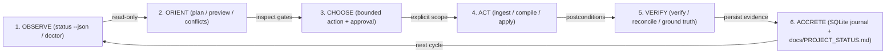

# Agent Operating Model

Stream Memory Manager operationalizes the standing agent-first directive through a six-phase deterministic control loop:



## 1. Zero-Archaeology State Inspection
A fresh agent entering the workspace needs **at most two commands** (`status --json` and `doctor --json`) to know:
- Whether local SQLite integrity, file permissions (`0700`/`0600`), and POSIX writer locks are clean.
- Exact record counts across canonical lifecycle states (`approved`, `pending_review`, `excluded`, `compiled_logs_total`).
- Active plan identity, status (`DRAFT`, `APPROVED`, `EXECUTING`, `PAUSED`, `BLOCKED`, `COMPLETED`, `CANCELLED`, `INVALIDATED`), and per-operation state breakdown.
- Rate-limit scheduler state (`consecutive_429s`, `cooldown_remaining_seconds`, `min_interval_seconds`).
- Whether remote writes are currently permitted (`remote_writes_allowed`), the exact `blocked_reason`, and the recommended `next_safe_action`.

## 2. Strict Machine-Readable Contracts
Every CLI command supports `--json`, emitting deterministic, sorted-key JSON with automatic secret redaction (`redact_object`). Error responses follow a single uniform JSON envelope:
```json
{
  "error": "Redacted human-readable diagnostic message",
  "error_class": "APPROVAL_REQUIRED",
  "exit_code": 3,
  "details": {}
}
```
All non-JSON human Rich output escapes markup (`rich.markup.escape` / `markup=False`) so untrusted document text can never inject terminal styling or corrupt agent-parsed logs.

## 3. Mode-to-Endpoint Isolation
Commands touching MCP endpoints require explicit `--mode`:
- `--mode dry-run`: Never opens network sockets; uses offline documented baseline capabilities; `apply` refuses to execute remote writes.
- `--mode mock`: Strictly restricted to loopback hosts (`127.0.0.1`, `localhost`, `::1`); refuses `https://api.sandbar.com/mcp`.
- `--mode live`: Strictly restricted to `https://api.sandbar.com/mcp` with TLS verification enabled; refuses localhost or arbitrary third-party URLs.
- `resume` defaults to `--mode dry-run` and refuses to mutate remote state unless the caller explicitly specifies `--mode mock` or `--mode live`.

## 4. Accretive Handoff Protocol
Every significant run leaves durable local state in SQLite (`operation_events`, `reconciliation_issues`, `capability_snapshots`, `evaluation_runs`) and updates [PROJECT_STATUS.md](PROJECT_STATUS.md) and [DECISION_LOG.md](DECISION_LOG.md) when architectural or operational milestones change. No future agent needs prior chat transcripts to resume safely.
