# System Architecture

## 1. Architectural Style
Stream Memory Manager is a **layered, local-first Python 3.12 application** structured around an authoritative SQLite WAL database (`data/stream_memory.db`) and a strict separation between **pure local knowledge management** and **fail-closed remote MCP execution**.

```mermaid
flowchart TD
    subgraph ui_layer ["Interface & Observability Layer"]
        cli_mod["cli.py (Typer CLI + --json)"]
        status_mod["status.py (Status Snapshot & Doctor)"]
    end

    subgraph kb_layer ["Local Knowledge Base Layer (Offline Safe)"]
        ingest_mod["ingestion.py (MD / JSON / TXT Parsers)"]
        recon_mod["reconciliation.py (Temporal & Supersession)"]
        priv_mod["privacy.py (NFKC Privacy & Injection Gate)"]
        reg_mod["registry.py (Canonical Records & Revisions)"]
        comp_mod["compiler.py (Deterministic <=900w Compiler)"]
        exp_mod["exporter.py (Open MD / JSON / Manifest)"]
        eval_mod["evaluator.py (Local BM25 + Native Kit)"]
    end

    subgraph exec_layer ["Remote Planning & Execution Layer"]
        plan_mod["planner.py (Immutable Plan Builder)"]
        sm_mod["state_machine.py (18-State Guard)"]
        exec_mod["executor.py (Journaled Execution & Reconcile)"]
        lock_mod["locking.py (POSIX flock Single-Writer)"]
        rl_mod["rate_limit.py (Persistent Pacing & Budget)"]
    end

    subgraph protocol_layer ["Sandbar MCP & Auth Transport Layer"]
        auth_mod["auth.py (OAuth 2.1 + PKCE + Keychain)"]
        cap_mod["capabilities.py (Schema Fingerprint)"]
        adp_mod["mcp_adapter.py (Streamable HTTP Client)"]
        mock_mod["mock_server.py (Stateful Local Simulator)"]
    end

    subgraph core_layer ["Foundation Layer"]
        db_mod["db.py (SQLite WAL + Online Backup)"]
        sec_mod["security.py (Redaction, Hashing, Path/URL Guards)"]
        mod_mod["models.py (Pydantic Models & Error Taxonomy)"]
        clk_mod["clock.py (SystemClock / FakeClock)"]
    end

    cli_mod --> status_mod
    cli_mod --> ingest_mod
    cli_mod --> priv_mod
    cli_mod --> comp_mod
    cli_mod --> plan_mod
    cli_mod --> exec_mod
    cli_mod --> exp_mod
    cli_mod --> eval_mod
    ingest_mod --> reg_mod
    recon_mod --> reg_mod
    priv_mod --> reg_mod
    comp_mod --> reg_mod
    plan_mod --> reg_mod
    plan_mod --> cap_mod
    exec_mod --> sm_mod
    exec_mod --> lock_mod
    exec_mod --> adp_mod
    adp_mod --> auth_mod
    adp_mod --> rl_mod
    adp_mod --> cap_mod
    reg_mod --> db_mod
    exec_mod --> db_mod
    rl_mod --> db_mod
    db_mod --> sec_mod
    exec_mod --> mod_mod
    rl_mod --> clk_mod
```

## 2. Module Responsibilities (23 Modules)

| Module | Single Cohesive Responsibility |
| :--- | :--- |
| `models.py` | Domain enums (`ExitCode`, `ExecutionMode`, `OperationState`, `PlanStatus`, `RecordStatus`, `EvidenceClass`, `PrivacyClassification`, `InclusionDecision`), Pydantic schemas, structured exception hierarchy. |
| `clock.py` | Deterministic `Clock` abstraction (`SystemClock` in production, `FakeClock` in tests for zero-sleep deterministic pacing and wall-clock jump tests). |
| `security.py` | NFKC + invisible-character normalization, secret detection & redaction, prompt-injection detection, endpoint/mode URL validation, canonical account scoping, atomic `0600`/`0700` file primitives, `O_NOFOLLOW`. |
| `db.py` | SQLite WAL manager (`PRAGMA foreign_keys=ON`, `synchronous=FULL`, `integrity_check`), transactional migrations, SQLite Online Backup with SHA-256 sidecars, schema-validated atomic restore. |
| `locking.py` | Kernel-managed POSIX `fcntl.flock(LOCK_EX | LOCK_NB)` single-writer account lock with diagnostic PID/host/nonce metadata. |
| `registry.py` | Canonical CRUD for `sources`, `memory_records`, `record_revisions`, `record_claims`, `record_relationships`, and `reconciliation_issues`; resets `inclusion_decision` on untrusted content revisions. |
| `privacy.py` | Hard-block secret/PII/security scanners, sensitive-review flags (preserving ADHD self-report vs formal diagnosis nuance), owner-local gitignored rules loader, fail-closed `assert_record_exportable()` and `assert_payload_safe()`. |
| `ingestion.py` | Parsers for ChatGPT V2 archives, Technical Supplements, generic Markdown, plain text, and untrusted JSON (stripping self-approval, rejecting reserved IDs and private-appendix paths). |
| `reconciliation.py` | Temporal precedence (`effective_date` / named-month parsing), evidence-class authority ranking, known V2-to-Tech supersessions, exact duplicate deduplication, inverted-index semantic overlap detection, and contradiction flagging. |
| `compiler.py` | Dual word counting (whitespace + conservative punctuation/CJK), formatting-preserving semantic splitter (`<= 900` conservative words incl. `2 * title_words`), duplicate-title rejection, `CORE — Knowledge Index`, `<= 140`-char folder instruction, and local briefing draft. |
| `exporter.py` | Open-format Markdown/JSON/manifest/sanitized-provenance export with revision freshness verification and zero-leak privacy re-scan. |
| `evaluator.py` | Stopword-filtered local BM25 evaluation (`MRR`, `Recall@1`, `Recall@3`, privacy leak verification) plus structured 12-dimension manual native Stream evaluation kit. |
| `rate_limit.py` | Shared account-level persistent request scheduler (default >= 2.0s spacing, clamped persisted cooldowns, monotonic in-process pacing, `Retry-After` honoring) and `BudgetTracker`. |
| `auth.py` | OAuth 2.1 + PKCE S256 + RFC 9728/8414/7591/7009/9207 loopback login, OS Keychain storage (fail-closed, opt-in 0600 file store), single-attempt validated token refresh, dual token revocation, and `AccountBindingManager`. |
| `capabilities.py` | Live MCP `tools/list` schema parser, capability flags (`supports_update_log`, `supports_set_briefing`, `supports_get_briefing`, etc.), SHA-256 schema fingerprinting, and offline documented baseline. |
| `mcp_adapter.py` | Official `mcp==2.3.0` Streamable HTTP client wrapper with `retries=0`, `follow_redirects=False`, `max_redirects=0`, scoped HTTP response observer, `BaseExceptionGroup` unwrapping, and fail-closed pagination. |
| `state_machine.py` | Formal 18-state directed transition graph enforcing all 324 `(from, to)` pairs and separating pre-write pauses from post-write verification pauses. |
| `planner.py` | Read-only remote observer (`observe_remote_state`), immutable plan generation with full-payload hashing, `approve_plan` (DRAFT-only under writer lock), and `cancel_plan` (pre-write ops only under writer lock). |
| `executor.py` | Crash-safe `OperationJournal`, preflight gates (binding, schema drift, privacy, revision freshness), single-flight write dispatch, read-after-write verification retries, and read-only ambiguous write reconciliation. |
| `status.py` | Compact agent status snapshot (`compute_system_status`) and read-only diagnostics (`run_doctor`). |
| `cli.py` | Agent-ergonomic Typer CLI with strict `--json` output, automatic secret redaction, Rich markup escaping, and mode-to-endpoint isolation. |
| `mock_server.py` | Stateful localhost Starlette/Uvicorn OAuth 2.1 + MCP server supporting configurable schema variants, cursor pagination, indexing lag, external edits, and deterministic fault injection. |

## 3. Single-Folder `Memory` Organization
Sandbar Stream supports flat folders only (no nesting). Stream Memory Manager targets **one dedicated folder named `Memory`**:
- **Folder Name:** `Memory` (6 chars <= 30-char Sandbar limit).
- **Folder Instruction:** `Dated personal & technical memory logs. Apply naturally; prefer newer corrections; separate built vs proposed; retrieve full logs.` (130 chars <= 140-char Sandbar limit).
- **Log Titles:** Category-prefixed (`CORE — ...`, `ENGINEERING — ...`, `RESEARCH — ...`, `PREFERENCES — ...`, `CURRENT — ...`, etc.) with `(Part X of Y)` suffixes only when semantic splitting is required.
- **Navigation Log:** `CORE — Knowledge Index` enumerating every active Log title and category so Stream can orient across the full memory corpus in a single lookup.
