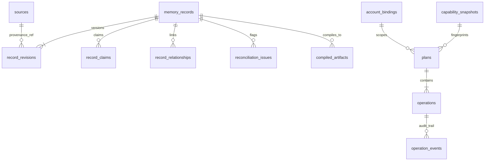

# Data Model & Persistence

## 1. SQLite Configuration & Hardening
All authoritative local state lives in a single SQLite database (`data/stream_memory.db`, schema v1):
- **Journal Mode:** `PRAGMA journal_mode=WAL` for crash durability and non-blocking concurrent readers (`status`, `doctor`, `inspect`) while a writer operates.
- **Durability:** `PRAGMA synchronous=FULL`, `PRAGMA foreign_keys=ON`, `PRAGMA busy_timeout=5000`.
- **Startup Integrity:** Checks the 16-byte `SQLite format 3\x00` header before opening (refuses to overwrite corrupted files) and runs `PRAGMA integrity_check` on every open.
- **File Security:** Created via `os.open(..., O_CREAT | O_EXCL | O_NOFOLLOW, 0o600)` inside a `0700` directory; WAL/SHM sidecars are also enforced to `0600`.
- **Transactions:** Explicit `BEGIN IMMEDIATE` transactions prevent writer deadlocks and guarantee atomic multi-table updates (e.g., marking an operation `VERIFIED` and updating `memory_records.remote_id` / `sync_status` in one atomic commit).

## 2. Entity-Relationship Schema

## 3. Core Tables (15 Tables)

| Table | Purpose | Key Invariants |
| :--- | :--- | :--- |
| `schema_migrations` | Versioned DDL ledger | Transactional upgrades; current `version = 1`. |
| `sources` | Registered raw input files with SHA-256 content hash | Immutable provenance root; excluded sources filtered out of sanitized exports. |
| `memory_records` | Stable logical record identity (`logical_id`), status, privacy class, inclusion decision, `remote_id`, `sync_status` | `logical_id` survives title/body edits; untrusted revisions reset prior `APPROVED` decision. |
| `record_revisions` | Append-only immutable revision history (`revision_id`, `content_checksum`, `superseded_by_revision_id`) | Historical revisions are never deleted or overwritten. |
| `record_claims` | Claim-level evidence classification (`ARTIFACT_INSPECTED`, `PROPOSED`, `USER_CONFIRMED`, etc.) | Separates implemented facts from proposed specs and unverified claims. |
| `record_relationships` | Directed links (`SUPERSEDES`, `SUPPLEMENTS`, `RELATES_TO`) | Preserves cross-record and supersession graph. |
| `reconciliation_issues` | Open/resolved conflicts, contradictions, overlaps, privacy holds, prompt-injection alerts | Open `CONTRADICTION` issues touching approved records block compilation. |
| `compiled_artifacts` | Deterministic compiled Stream Logs (`artifact_key`), folder instruction, briefing draft, `payload_hash`, `normalized_payload_hash`, word counts | Tracks `revision_number` so stale artifacts fail closed on export, planning, and execution. |
| `capability_snapshots` | Observed MCP `tools/list` snapshots with SHA-256 `schema_fingerprint` | Schema drift invalidates plans before writes execute. |
| `account_bindings` | Bound `(profile_name, server_url, issuer, account_id)` + `binding_hash` | Prevents cross-account write leakage. |
| `plans` | Immutable execution plans (`plan_id`, `mode`, `status`, `budget_json`, `approval_*`, `summary_json`) | Only `DRAFT` plans can be approved; cancelled/invalidated plans never silently reused. |
| `operations` | Individual journaled remote operations (`op_id`, `op_type`, `state`, `attempt_count`, `verification_attempts`, `remote_id`, `remote_last_update_ts`) | Every transition validated by `state_machine.validate_transition`. |
| `operation_events` | Append-only audit log of every state transition + JSON detail | Full forensic replayability across restarts. |
| `rate_limit_state` | Account-scoped persistent pacing floor (`next_allowed_epoch_ms`, `consecutive_429s`, `total_requests`) | Prevents post-restart bursts; clamps clock-jump anomalies to `<= 3600s`. |
| `evaluation_runs` | Recorded local BM25 evaluation runs (`eval_type`, `results_json`) | Tracks retrieval quality longitudinally over corpus updates. |

## 4. Backup & Restore Guarantees
- **Backup (`db.backup_to`):** Uses SQLite's native Online Backup API (`sqlite3.Connection.backup`), ensuring a transactionally consistent snapshot even while WAL files exist. Writes a `0600` `.db` file and a companion `.backup.json` sidecar containing the SHA-256 digest, schema version, and per-table row counts. Rejects invalid/traversal labels (`^[A-Za-z0-9_-]{1,48}$`).
- **Restore (`restore_backup`):** Verifies (1) valid SQLite header, (2) sidecar SHA-256 checksum (refused if missing unless explicitly overridden), (3) `PRAGMA integrity_check == ok`, and (4) presence of all required Stream Memory Manager tables **before** acquiring the writer lock and atomically swapping the live database. A bad or foreign database can never clobber live data.
