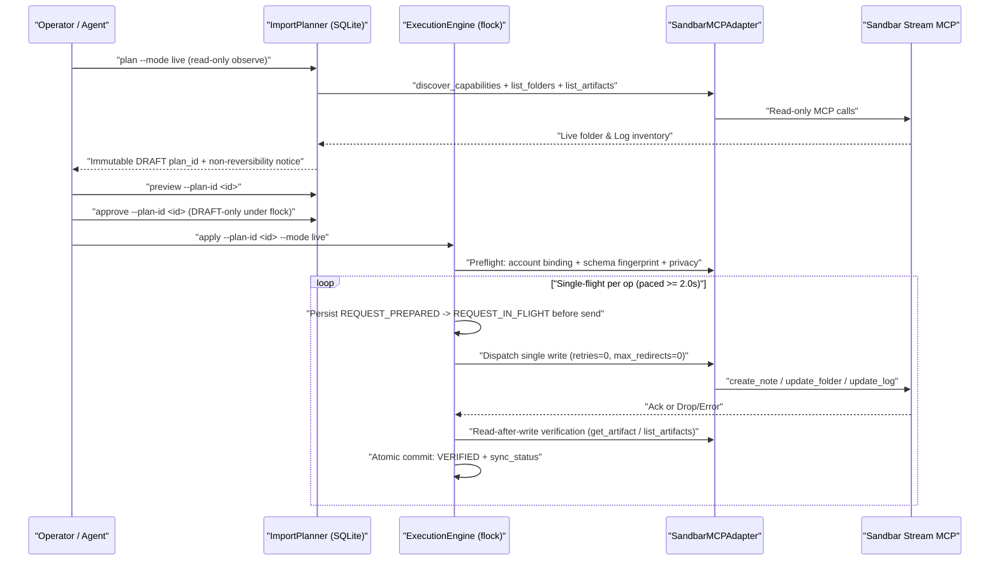

# Import Protocol (`planner.py` & `executor.py`)

## 1. End-to-End Bounded Execution Lifecycle

## 2. Immutable Plan Identity & Approval Rules
- `plan_id` is deterministically hashed from `{mode, account_binding_hash, target_folder_name, target_folder_id, capability_fingerprint, compiler_version, budget, full operation payload_hashes and sequence}`.
- **DRAFT-Only Approval:** `approve_plan()` acquires the account writer lock and transitions `DRAFT -> APPROVED` inside `BEGIN IMMEDIATE`. Attempting to approve a `CANCELLED`, `INVALIDATED`, `APPROVED`, or `COMPLETED` plan fails closed (`ApprovalRequiredError`).
- **Fresh Re-Planning After Cancel/Invalidation:** If an identical plan input already exists in a non-`DRAFT` state (`CANCELLED`, `INVALIDATED`, `COMPLETED`), `build_plan()` mints a fresh `DRAFT` plan (`<base_plan_id>_v2`, etc.) rather than trapping the operator on a dead plan.
- **Explicit Cancellation (`pause` / `cancel_plan`):** Acquires the account writer lock, re-reads every operation inside `BEGIN IMMEDIATE`, and cancels **only** operations in `PRE_WRITE_CANCELLABLE_STATES` with `remote_id IS NULL`. Already-dispatched, verified, or post-write paused operations are never falsely marked `CANCELLED_BEFORE_WRITE`.

## 3. Preflight Safety Gates (Executed Before Every Mutating Run)
Before dispatching a single write, `ExecutionEngine.execute_plan()` verifies ALL seven gates:
1. **Writer Lock:** Acquires exclusive non-blocking POSIX `flock` on `canonical_account_scope`.
2. **Mode & Approval:** Refuses `DRY_RUN` execution; requires `plan.status in (APPROVED, EXECUTING, PAUSED)`.
3. **Crash Recovery Sweep:** Promotes any stale `REQUEST_IN_FLIGHT` row from a prior crashed process to `UNCERTAIN_REMOTE_OUTCOME` and resets un-sent `REQUEST_PREPARED` rows to `READY`.
4. **Blocking Check:** Refuses to issue any new writes while ANY operation is in `UNCERTAIN_REMOTE_OUTCOME`, `CONFLICTED`, or `BLOCKED` (must reconcile read-only first!).
5. **Account Binding Check:** Verifies live authenticated `account_id` matches the plan's bound `account_id` (`AccountMismatchError` on mismatch).
6. **Capability & Schema Drift Check:** Re-runs `discover_capabilities()`; if `schema_fingerprint` changed, marks the plan `INVALIDATED` and stops immediately (`SchemaDriftError`).
7. **Live Privacy & Revision Freshness Re-Check:** Re-verifies every planned `CREATE_LOG` / `UPDATE_LOG` artifact against current `memory_records` (blocking retroactive exclusions, privacy violations, or stale revisions even if modified after plan approval!).

## 4. Safe Folder Instruction & Briefing Guards
- **Duplicate `Memory` Folders:** If `list_folders` returns `> 1` folder named `Memory`, both planning and execution fail closed (`ExitCode.BLOCKED_CONFLICT`).
- **Folder Instruction:** Never overwrites a non-empty user-authored `Memory` folder instruction; sends `expected_last_update_ts` optimistic concurrency token and enforces `<= 140` chars.
- **Briefing Guard:** Omits `SET_BRIEFING` unless live capabilities advertise **both** `supports_set_briefing` AND `supports_get_briefing` AND existing remote briefing is either empty or previously managed by Stream Memory Manager.
