# Formal Operation State Machine (`state_machine.py`)

Every remote mutation in Stream Memory Manager is governed by a strict **18-state directed transition graph** (`324` total `(from, to)` pairs verified deterministically in `tests/test_state_machine.py`). Every state update in `OperationJournal.transition()` executes `validate_transition(current, target)` inside a `BEGIN IMMEDIATE` SQLite transaction and records an immutable row in `operation_events`.

## 1. Directed State Graph

```mermaid
stateDiagram-v2
    [*] --> PLANNED
    PLANNED --> APPROVED : "explicit approve"
    PLANNED --> BLOCKED : "conflict or preflight"
    PLANNED --> CONFLICTED : "remote conflict"
    PLANNED --> CANCELLED_BEFORE_WRITE : "user cancel"

    APPROVED --> READY : "execution start"
    APPROVED --> PAUSED_AUTHORIZATION : "pre-write 401"
    APPROVED --> BLOCKED : "gate failure"
    APPROVED --> CONFLICTED : "remote conflict"
    APPROVED --> CANCELLED_BEFORE_WRITE : "user cancel"

    READY --> REQUEST_PREPARED : "journal before send"
    READY --> PAUSED_AUTHORIZATION : "pre-write 401"
    READY --> PAUSED_RATE_LIMIT : "pre-write 429"
    READY --> BLOCKED : "preflight block"
    READY --> CONFLICTED : "conflict"
    READY --> FAILED_CONFIRMED : "local validation fail"
    READY --> CANCELLED_BEFORE_WRITE : "user cancel"

    REQUEST_PREPARED --> REQUEST_IN_FLIGHT : "socket dispatch"
    REQUEST_PREPARED --> READY : "crash pre-dispatch"
    REQUEST_PREPARED --> RETRY_WAIT : "pre-send backoff"
    REQUEST_PREPARED --> PAUSED_AUTHORIZATION : "auth failure"
    REQUEST_PREPARED --> PAUSED_RATE_LIMIT : "429 pause"
    REQUEST_PREPARED --> FAILED_CONFIRMED : "confirmed reject"
    REQUEST_PREPARED --> BLOCKED : "blocked"
    REQUEST_PREPARED --> CANCELLED_BEFORE_WRITE : "user cancel"

    REQUEST_IN_FLIGHT --> ACKNOWLEDGED : "server ack"
    REQUEST_IN_FLIGHT --> UNCERTAIN_REMOTE_OUTCOME : "drop or crash or 5xx"
    REQUEST_IN_FLIGHT --> RETRY_WAIT : "confirmed 429 pre-commit"
    REQUEST_IN_FLIGHT --> PAUSED_AUTHORIZATION : "confirmed 401 pre-commit"
    REQUEST_IN_FLIGHT --> PAUSED_RATE_LIMIT : "confirmed 429 streak"
    REQUEST_IN_FLIGHT --> CONFLICTED : "expected_ts mismatch"
    REQUEST_IN_FLIGHT --> FAILED_CONFIRMED : "confirmed validation error"

    RETRY_WAIT --> READY : "after Retry-After"
    RETRY_WAIT --> PAUSED_AUTHORIZATION : "401"
    RETRY_WAIT --> PAUSED_RATE_LIMIT : "streak cap"
    RETRY_WAIT --> BLOCKED : "budget cap"
    RETRY_WAIT --> FAILED_CONFIRMED : "permanent error"
    RETRY_WAIT --> CANCELLED_BEFORE_WRITE : "user cancel"

    PAUSED_AUTHORIZATION --> READY : "re-auth resume"
    PAUSED_AUTHORIZATION --> BLOCKED : "account mismatch"
    PAUSED_AUTHORIZATION --> CANCELLED_BEFORE_WRITE : "user cancel"

    PAUSED_RATE_LIMIT --> READY : "cooldown elapsed"
    PAUSED_RATE_LIMIT --> BLOCKED : "budget cap"
    PAUSED_RATE_LIMIT --> CANCELLED_BEFORE_WRITE : "user cancel"

    ACKNOWLEDGED --> AWAITING_VERIFICATION : "verify read"
    ACKNOWLEDGED --> VERIFIED : "verified postcondition"
    ACKNOWLEDGED --> CONFLICTED : "mismatch"
    ACKNOWLEDGED --> BLOCKED : "corrupt response"

    AWAITING_VERIFICATION --> VERIFIED : "read-after-write match"
    AWAITING_VERIFICATION --> AWAITING_VERIFICATION : "bounded lag poll"
    AWAITING_VERIFICATION --> PAUSED_VERIFICATION_AUTH : "401 during verify"
    AWAITING_VERIFICATION --> PAUSED_VERIFICATION_RATE_LIMIT : "429 during verify"
    AWAITING_VERIFICATION --> UNCERTAIN_REMOTE_OUTCOME : "ambiguous verify"
    AWAITING_VERIFICATION --> CONFLICTED : "content mismatch"
    AWAITING_VERIFICATION --> BLOCKED : "lag window exhausted"

    PAUSED_VERIFICATION_AUTH --> AWAITING_VERIFICATION : "resume verify ONLY"
    PAUSED_VERIFICATION_AUTH --> BLOCKED : "unresolvable"

    PAUSED_VERIFICATION_RATE_LIMIT --> AWAITING_VERIFICATION : "resume verify ONLY"
    PAUSED_VERIFICATION_RATE_LIMIT --> BLOCKED : "unresolvable"

    UNCERTAIN_REMOTE_OUTCOME --> AWAITING_VERIFICATION : "read-only reconcile"
    UNCERTAIN_REMOTE_OUTCOME --> CONFLICTED : "ambiguous or diverged"
    UNCERTAIN_REMOTE_OUTCOME --> BLOCKED : "unresolvable"

    BLOCKED --> AWAITING_VERIFICATION : "manual reconcile"
    BLOCKED --> CONFLICTED : "conflict confirmed"

    CONFLICTED --> BLOCKED : "escalated"

    VERIFIED --> [*]
    FAILED_CONFIRMED --> [*]
    CANCELLED_BEFORE_WRITE --> [*]
```

## 2. Formally Proven Safety Properties (Hypothesis `RuleBasedStateMachine`)
Verified across 200 stateful execution traces of up to 35 transitions each (`tests/test_state_machine.py`):
1. **Zero Multi-Hop Blind Re-Dispatch:** Once an operation enters ANY post-write or uncertain state (`ACKNOWLEDGED`, `AWAITING_VERIFICATION`, `PAUSED_VERIFICATION_AUTH`, `PAUSED_VERIFICATION_RATE_LIMIT`, `UNCERTAIN_REMOTE_OUTCOME`), there is **zero path of any length** back to `READY`, `REQUEST_PREPARED`, `RETRY_WAIT`, or `REQUEST_IN_FLIGHT`.
2. **Post-Write Verification Pause Isolation (Audit R1):** Separating `PAUSED_VERIFICATION_AUTH` and `PAUSED_VERIFICATION_RATE_LIMIT` from pre-write `PAUSED_AUTHORIZATION` / `PAUSED_RATE_LIMIT` eliminates both 2-hop duplicate write re-dispatch on `resume` and false `CANCELLED_BEFORE_WRITE` transitions on `pause`.
3. **Zero Post-Write False Cancellation:** Neither post-write pause states nor `BLOCKED` / `CONFLICTED` / `UNCERTAIN_REMOTE_OUTCOME` can transition to `CANCELLED_BEFORE_WRITE` (proven mathematically across all paths by Hypothesis).
4. **Acknowledgment vs Verification Separation:** `REQUEST_IN_FLIGHT` can never jump directly to `VERIFIED`; every verified write must traverse `ACKNOWLEDGED` or `AWAITING_VERIFICATION`.
5. **Terminal Absorption:** `VERIFIED`, `FAILED_CONFIRMED`, and `CANCELLED_BEFORE_WRITE` have zero outgoing edges.
